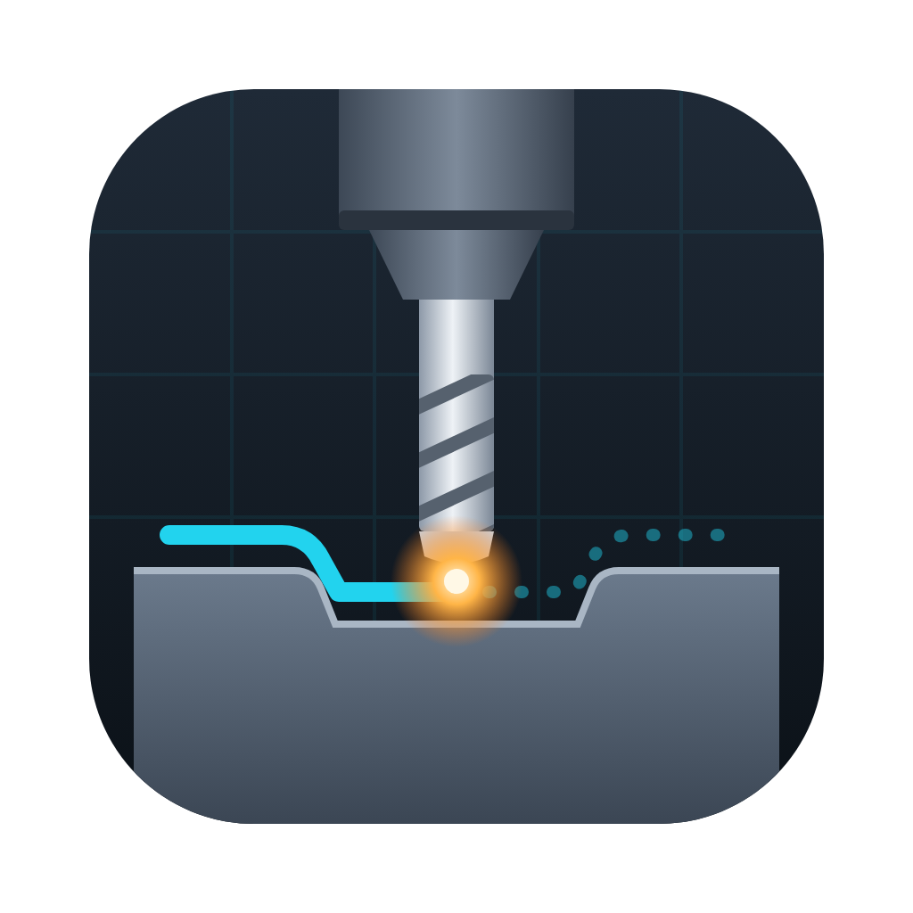
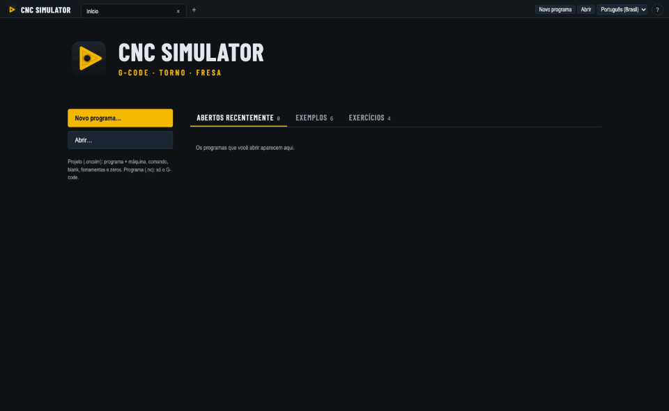

# CNC Simulator

[Português (Brasil)](README.pt-BR.md) · English

[](https://github.com/ismael-figueiredo/cnc-simulator/releases/latest) [](https://github.com/ismael-figueiredo/cnc-simulator/releases) [](https://github.com/ismael-figueiredo/cnc-simulator/actions/workflows/ci.yml) [](LICENSE)

**Free, open-source CNC simulator to learn and test G-code**, with no machine needed: lathes and machining centers, Fanuc, Mitsubishi and Haas controls, Macro B parametric programs, the control's own alarms and collision checks. For Windows, macOS and Linux.

Website: **[ismael-figueiredo.github.io/cnc-simulator](https://ismael-figueiredo.github.io/cnc-simulator/)**

It reads G-code, takes the **machine** and the **control** from JSON files (a post-processor in reverse) and shows the toolpath and the machined part in 3D.



## Who it is for

- **CNC students:** write a program, run it block by block, see what each code does and which alarm the control would give, without risking a machine.
- **Programmers:** check what the CAM post-processor generated before it reaches the machine: alarms, travel limits, holder and chuck collisions, tool offsets.
- **Teachers and technical schools:** a free tool that every student can install at home, with ready examples for lathe and machining center.
- **Parametric programming:** learn and test Macro B (variables, IF/WHILE, G65) on the simulator before trying it on the control.

## Download

Installers for every version are on the **[Releases page](https://github.com/ismael-figueiredo/cnc-simulator/releases/latest)**:

| System | File | Notes |
|---|---|---|
| Windows 10/11 | `cnc-simulator-<version>-setup.exe` | Windows may warn about an unknown publisher (the app is not signed): **More info → Run anyway**. Updates install themselves. |
| macOS (Apple Silicon) | `cnc-simulator-<version>-arm64.dmg` | Drag to Applications. First launch: right-click the app → **Open** (not signed). |
| macOS (Intel) | `cnc-simulator-<version>-x64.dmg` | Same as above. |
| Linux | `cnc-simulator-<version>-x86_64.AppImage` or `cnc-simulator_<version>_amd64.deb` | The AppImage updates itself; the .deb is updated by installing the new one. |

## What it does

- **Runs G-code like the control:** Fanuc, Mitsubishi and Haas dialects from JSON, Macro B (variables, IF/WHILE/GOTO, G65), subprograms, canned cycles, G12.1 polar interpolation and G41/G42 cutter compensation drawn as the tool center.
- **Parametric programs (Macro B):** variables, math and IF/GOTO/WHILE run as on the control, on every bundled machine (all their controls have the macro option). Plain G-code and the control's own canned cycles run too; the examples have both.
- **Stops on the machine's alarms:** program errors stop at the block with the control's own number and message (for example `PS0010 IMPROPER G-CODE`).
- **Operator panel:** single block, M01 optional stop, block delete "/", feed and rapid overrides (the cycle time follows them), and breakpoints on any line.
- **Screen like the machine:** the **Machine** screen is laid out like a control (no maker's branding): the display with its title bar (page, MEM/EDIT, STRT/HOLD, ALM), position with machine coordinates and distance to go, spindle and feed with load bars and overrides, the program; **soft keys** under it; the **MDI keys** beside it (POS, PROG, OFS/SET, SYSTEM, MESSAGE, GRAPH switch pages; RESET; the cursor and PAGE keys step through the program); and the **operator panel** below: MODE (EDIT/MEM), **CYCLE START** and **FEED HOLD**, SINGLE BLOCK, OPT STOP, BLOCK SKIP and the **feed, rapid and spindle override knobs**. An alarm shows across the top of the screen with its number and short text; the MESSAGE page has the full message. Keyboard: **Space** cycle start / feed hold, **Esc** reset, **S** single block. The simulation speed and timeline stay apart, under the panel.
- **3D model, as in CAD programs:** a **feature tree** on the left (program, machine, stock, work offsets, tools, the operations the program makes and its messages; click an operation to go to it and highlight it in 3D), the program under it, and the model with a **view toolbar** (fit, iso/top/front/side, what is shown, orthographic or perspective, follow tool, measure) and a **view cube** to click. Views are exact (Top and Front are really flat) and the camera is **orthographic** by default; **F** fits the part. The **timeline** under the slider is colored by tool and marks M00/M01 stops, breakpoints, collisions and the alarm; an alarm also shows as a red line across the top of the view.
- **First-use tour:** a short walk through the screen the first time a program opens, and again from the **?** at the top right (with learning mode and the keyboard shortcuts).
- **Learning mode (?):** hover a G/M code, a #variable or a macro word in the program (or in the editor) to see what it does on the selected control; the block at the cursor is explained word by word under the program. G71 on a Fanuc lathe, M97 on a Haas: the help follows the control.
- **Guided exercises:** four exercises on the start screen, from a shaft with G00/G01 to a row of holes with WHILE. Each opens with its machine, stock, statement and a drawing of the part; **Check** machines your program and the solution on the same stock and says where material is left or the part was cut into.
- **Program screen like the control:** Fanuc-style MEM screen with the running block, O and N numbers and run state. **EDIT** turns it into an editor (colors, undo, find and replace); it stops a running program, and the path, messages and alarms follow the text as you type.
- **Tool offsets:** OFFSET screen with H/D (machining centers) or X/Z, nose radius and tip (lathes), geometry and wear; a wrong H moves the tip as on the machine; lathe nose radius compensation G41/G42.
- **Lathe canned cycles:** G71/G72 roughing, G73 pattern repeating and G70 finishing from the shape between P and Q; G90/G94/G92 (system A) and G77/G79/G78 (system B) single cycles; G76 multiple threading and G32/G33 thread cutting at the lead per revolution. The stock is turned pass by pass.
- **Automatic chamfer and corner R:** `,C` and `,R` at any angle, with the tangent arc followed by cutter compensation, and the control's alarms when they cannot be made. Lathes can also take `C`/`R` without comma (control option `cornerWithoutComma`).
- **Projects (`.cncsim`):** keep the program with its machine, control, tools, stock and work offsets, to reopen or send the whole job.
- **Tools in 3D:** each tool is drawn from its type and lengths with its holder (BT40 tapers, ER collets, live tool holders) and a faded spindle nose on machining centers. Turning tools show their ISO insert, external or internal, right or left hand.
- **Machining view:** the stock changes color and shape where the tool cuts: a heightfield on blocks (flat and ball end mills) and the turned profile on bars. Rapids and live tooling on lathes do not cut in this view yet.
- **Possible collisions:** when a holder goes into the stock (the tool sticks out too little for the depth), the block is listed and the holder turns red. On lathes, a tool that reaches the jaws or the chuck body is listed and the jaws turn red.
- **Stock tools:** fit the stock to what the program cuts with one click, and put the work zero on a corner or the center of the block.
- **Lathe machine view:** the chuck and the part turn in C while the tool stays in X/Z, as on the machine; the chuck spins when turning.
- **Tools:** create and edit tools (mount, side, hand, insert; helix and insert drawings in the editor), save them as libraries and reuse them in any project.
- **Stock:** bar or block, size, position and material color.
- **Work offsets:** G54–G59 and G54.1 P n, G10 L2/L20 in the program, G53 in machine coordinates, absolute and machine position side by side, and travel limit warnings.
- **Help menu:** report a problem (with a screenshot and a prefilled GitHub issue) and check for updates.
- **Languages:** Portuguese (Brazil), English and Spanish.

## Using it

1. **Start screen:** **New program…** and **Open…** on the left; the **Recent**, **Examples** and **Exercises** tabs on the right. Each document opens in its own **tab**, like a browser: several programs side by side, each with its machine and simulation (Ctrl/⌘+W closes the tab, **+** brings the start screen back). Two kinds of file: a **project (.cncsim)** keeps the program with its machine, control, stock, tools and work offsets; a **program (.nc, .tap, .txt…)** is only the G-code.
2. **Machine and control:** a program opened alone asks for its machine, control and tool library first, with a guess from its own codes (G18 and T0101 → lathe, G154 → Haas…), so it does not open full of alarms for the wrong machine. A project opens as saved. The **status bar** at the bottom shows the file kind, machine, control and tools, and changes them.
3. **Run:** the program opens at RESET, cursor on the first block, as on the control. **▶ Run** plays it; step block by block with ◀ and ▶|; **RESET** goes back to the start and ⏭ to the end. **Click a block to start from it**, or **click its line number** to stop there (breakpoint). Under the player: **SINGLE BLOCK**, **M01**, **BLOCK DELETE /** and the **feed and rapid overrides**. The active G codes, F, S, T and canned cycle are shown above the program. Messages and alarms are listed on the right (MESSAGE page on the machine screen); click one to go to its block.
4. **EDIT / MEM:** EDIT changes the program and stops it if it was running; while you type, the path and messages are recomputed (the program goes back to RESET). MEM runs it as edited. **File → Save** (Ctrl/⌘+S) writes it back.
5. **Setup:** in the right panel (SETTING and OFFSET pages on the machine screen), edit the **Stock** (or fit it to the program, and choose where the work zero sits on it), the **Work offsets** and the **Tools**, then **Save as project (.cncsim)** to keep it all next to the program. The disk icon above the program saves only the program (`.nc`).

### Learn with the examples

Start with the **exercises** on the start screen (E01 to E04, with **Check**), then open the examples, in this order:

| Example | Machine | What it teaches |
|---|---|---|
| **O1001** stepped shaft | Romi GL 300 lathe | Facing, roughing passes by hand, finishing with automatic `,C` chamfers and `,R` radii, grooving |
| **O1002** threaded shaft | Romi GL 300 lathe | The same part with canned cycles: G71 roughing, G70 finishing, G76 thread |
| **O2001** plate | Romi D600 machining center | Face milling, contour with G41, pocket, drilling and tapping cycles G81/G83/G84, engraving; T7 shows a holder collision |
| **O2002** two vises | Romi D600 machining center | G54 and G55 work offsets, M98/M99 subprograms, machine coordinates |
| **O3001** two fixtures | Haas VF-2 | The same job on Haas: G154 work offsets and M97 local subprograms |
| **O1500** sprocket | Romi GL 250 M lathe | A full Macro B parametric program with live tooling and G12.1 |

### Before sending a program to the machine

| Check | Where it shows |
|---|---|
| Program errors (wrong code, missing word, bad arc) | Red alarm with the control's number, at the block |
| Travel limits | Warning with the axis and the block, from the machine's travels |
| Holder into the stock, tool into the chuck jaws | Collision list; the holder or jaws turn red in 3D |
| Wrong H or D, missing tool offset | OFFSET table and warnings; a wrong H moves the tip as on the machine |
| Cycle time | Shown under the position, following the feed and rapid overrides |

### Parametric programming (Macro B)

Every bundled control (Fanuc 0i-TF, 0i-MF, Romi D line, Mitsubishi M80 lathe and machining center, Haas NGC mill) has the macro option, so these run in the simulator as on the machine:

- **Variables:** locals `#1–#33`, commons `#100–#199` and `#500–#999`, and system variables such as `#5001–#5003` (absolute position) and `#5021–#5023` (machine position).
- **Math and functions:** `+ - * /`, `SIN COS TAN ASIN ACOS ATAN SQRT ABS ROUND FIX FUP`, brackets.
- **Flow:** `IF [...] GOTO n`, `IF [...] THEN`, `WHILE [...] DOn … ENDn`, with `EQ NE GT LT GE LE AND OR`.
- **Calls:** `G65 P… A… B…` with arguments, `M98`/`M99` subprograms in the same file.
- **Alarms:** `#3000 = n (message)` stops the run with the control's alarm number.

**File → New program** asks for **plain G-code** or **parametric**. Both start with a header written in the selected control's own codes (units, plane, safe cancels, first tool, spindle, coolant, program end, and `;` at the end of blocks when the control needs it). The parametric one adds parameters to change (`#100…`) and a `WHILE` loop that makes the passes down to the depth.

The **O1500** example is a full parametric program (an ANSI 40 sprocket computed from the number of teeth); **O2001** and **O2002** are plain G-code with canned cycles (G81, G83, G84) and subprograms; **O3001** is the Haas version, with G154 work offsets and M97 local subprograms.

### Work offsets: what changes the simulation

- **One work offset:** the path does not change on the part. Its values (machine position of the part zero) place machine zero, so the **Machine** column, G53/G28 and the travel check become real.
- **Several work offsets** (two vises, two faces): each one is drawn shifted by its difference to G54, and the stock sits on the offset you choose.
- **G10 L2 / L20** in the program write the table while it runs, as on the machine.
- **Tool offsets count too:** G43 H puts the spindle gauge line at Z + H, so machine positions and travel checks are real; see below.

### Tool offsets

**Tool offsets** (right panel) is the control's OFFSET screen, saved in the project and filled from the tools at first (gauge length = holder + tool, radius, nose radius).

- **Machining centers:** `G43 H` reads the length, `G41/G42 D` the radius; wear adds to geometry. If H is not the real length of the tool in the spindle, the tip is drawn where it really goes (a shorter H plunges deeper) and a warning gives the difference. Cutting without G43 is warned too.
- **Lathes:** the T word picks the offset (`T0101` → 01). X/Z wear moves the tip, R and T (tip direction) drive **nose radius compensation** G41/G42, geometry goes into the machine position.
- **G10** writes offsets while the program runs: L10–L13 on machining centers, `G10 P n` (wear) and `P 10000+n` (geometry) on lathes.

### Reporting problems

**Help → Report a problem** explains how to post, saves a screenshot of the window to Downloads (and copies it), and opens a [GitHub issue](https://github.com/ismael-figueiredo/cnc-simulator/issues) with the version and system already filled in. **Help → Known problems** opens the issue list.

### Community

- **Questions and programs:** [Discussions](https://github.com/ismael-figueiredo/cnc-simulator/discussions), for programming questions and to show what you made.
- **A machine or control you need:** open a [machine or control request](https://github.com/ismael-figueiredo/cnc-simulator/issues/new?template=machine.yml).
- **Contributing:** machines, controls and alarms are JSON files; [CONTRIBUTING.md](CONTRIBUTING.md) explains how to add one.

# For developers

It grew out of `Simulador_Fanuc.html` ([docs/legacy](docs/legacy/Simulador_Fanuc.html)), a single-file simulator that already handled Fanuc Macro B, G12.1 and G41/G42 cutter compensation on a Romi GL lathe with live tooling. This project rewrites it in TypeScript, split into core, UI and desktop app, and is no longer tied to one control.

## Requirements

- Node.js 22.12 or newer
- Windows 10/11, macOS (Apple Silicon and Intel) or Linux (AppImage or .deb)

## Getting started

```bash
npm install                          # dependencies
node node_modules/electron/install.js  # Electron binary (since Electron 45 it is not fetched by npm install)
npm run dev          # desktop app with hot reload
npm run check        # types + lint + tests: run before every commit
npm test             # tests only (Vitest)
npm run typecheck    # types only
npm run lint         # lint only (ESLint, zero warnings allowed); lint:fix fixes what it can
npm run build        # check, then build to out/ (build:only skips the check)
npm run server       # browser mode at http://localhost:5174 (run npm run build first)
npm run dist         # installer for the current OS in dist/
npm run dist:win     # Windows installer (NSIS)
npm run dist:mac     # macOS dmg, arm64 and x64 (run on a Mac; unsigned)
npm run dist:linux   # Linux AppImage and .deb
npm run icons        # redraw build/icon.png, the favicon, installer artwork and docs/social.png after editing build/icon.svg
npm run demo         # record docs/demo.gif (start screen + the example running) for the README
```

After a visible UI change, run `npm run demo` and commit the new `docs/demo.gif` with it, so the README shows the current app.

### Troubleshooting

- **`npm run dev` fails with `Cannot read properties of undefined (reading 'handle')` and "Node.js" in the trace:** the environment has `ELECTRON_RUN_AS_NODE=1`, which some VS Code extensions set. Electron then runs as plain Node. Clear it first:
  - PowerShell: `Remove-Item Env:ELECTRON_RUN_AS_NODE`
  - Git Bash: `unset ELECTRON_RUN_AS_NODE`

### Release builds

- **CI:** every push to `main` and every pull request runs `npm run check`.
- **Release notes:** each version is described in [CHANGELOG.md](CHANGELOG.md) (Portuguese and English). Tag a release with that text as an annotated tag message (`git tag -a vX.Y.Z --cleanup=verbatim -F notes.md`, so the `###` headings are kept); the Release workflow puts it on the release page.
- **Release:** pushing a `v*` tag (`git tag v0.1.0 && git push origin v0.1.0`) builds the Windows, macOS and Linux installers and publishes them on the GitHub Releases page. Running the workflow by hand from the Actions tab only keeps them as run artifacts.
- **Installer screens:** the Windows installer shows the license and the artwork in `build/` (sidebar and header BMPs); the macOS disk image shows a background with the drag-to-Applications arrow. `npm run icons` renders all of them from `build/icon.svg`.
- **Website and social preview:** `docs/index.html` is the GitHub Pages site (branch `main`, folder `/docs`); it links the installers of the latest release. `docs/social.png` is the image for **Settings → Social preview**.

### Updates

The installed app checks the latest GitHub release on start, and from **Help → Check for updates**.

- **Windows (.exe) and Linux (.AppImage):** the update downloads in the background and installs on restart (electron-updater reads the `latest*.yml` files the Release workflow publishes).
- **macOS and Linux (.deb):** the app says a new version exists and opens the download page. macOS only installs updates for signed apps; the `.deb` belongs to the system package manager.
- Being offline is not an error: the check on start fails silently.

### Issue form

`.github/ISSUE_TEMPLATE/bug.yml` asks for version, system, machine and control, what happened and the program blocks; **Help → Report a problem** prefills the first two.

## Quality checks

`npm run check` must pass with no errors and no warnings. `npm run build` (and therefore every `dist` script) runs it first and stops on any failure.

- **Types:** `tsc` in strict mode with `noUncheckedIndexedAccess`.
  - TypeScript stays on **6.0** because typescript-eslint does not support the native TypeScript 7 yet.
- **Lint:** ESLint 10 with `typescript-eslint` **strict type-checked** rules, React hooks rules (React Compiler aware) and `eqeqeq`.
  - Callbacks in interfaces are written as properties (`onSeek: (t: number) => void`).
- **Tests:** Vitest.
  - The O1500 sprocket with 9/15/20 teeth: the Ø6 cutter center must stay exactly 3.000 mm from the ANSI profile, and the Ø8 relief holes must leave stock.
  - The Romi manual G42 example.
  - Rule violations, Macro B and a mill program.
  - Work offsets: G55 shifted from G54, machine coordinates, G53, G10 L2/L20, overtravel, and no change without a table.
  - Project files: valid and invalid `.cncsim` files.
  - Every diagnostic and UI text exists in every language.
- **VS Code:** `.vscode/` recommends the ESLint extension and fixes on save.

## Languages

The code base, config files and docs are in English. The UI is translated, with **Portuguese (Brazil)** as the default, plus English and Spanish.

- **Catalogs:** `src/i18n/locales/` holds one catalog per language. `en.ts` is the source; the compiler rejects any other catalog that misses or adds a key, and a test checks that every `{placeholder}` is kept.
- **Adding a language:**
  1. Copy `pt-BR.ts`.
  2. Translate it.
  3. Add it to `LANGUAGES` in `src/i18n/index.ts`.
- **Picking the language:**
  - **Desktop:** the native menu **Settings → Language**. The renderer stores the choice. Every native menu item is translated; built-in Electron role menus are not used because their items stay in English.
  - **Browser mode:** a selector in the header, since there is no menu bar.
- **Config validation messages:** use zod's own locales.
- **Config files:** any user-facing text (`name`, `description`) can be a plain string or one string per language:
  ```json
  "name": { "en": "Live tool", "pt-BR": "Ferramenta acionada", "es": "Herramienta motorizada" }
  ```
  Missing languages fall back to English.
- **Core diagnostics:** the interpreter will report a `code` plus `params`, never a sentence, so each language words them its own way.

## Stack

| Part | Technology | Why |
|---|---|---|
| Core (`src/core`) | Plain TypeScript | Runs the same in the app, the server and the tests |
| i18n (`src/i18n`) | Plain TypeScript, typed catalogs | Shared by UI, main process and server; no dependency |
| UI (`src/renderer`) | React + TSX, three.js via @react-three/fiber and drei | Declarative 3D view in TSX |
| Desktop (`src/main`, `src/preload`) | Electron + electron-vite | One code base for Windows, Linux and macOS |
| Configs | JSON validated with zod | Readable errors; TS types come from the schemas |
| HTTP (optional) | Fastify | Browser mode and simulation API |
| Installer | electron-builder | NSIS (Windows, multi-language), AppImage, dmg |
| Tests | Vitest | |

## Layout

```
src/
  core/            no DOM: types, schemas and the interpreter
    config/        schema.ts (zod), project.ts (.cncsim), load.ts (validation, issues as data)
    interp/        simulate.ts (interpreter), cutterComp.ts, diagnostics.ts
  i18n/            languages, translate(), localize(); locales/en.ts is the source
  main/            Electron main process: window, menus, files
  preload/         safe typed bridge between window and system (api.ts)
  renderer/        React UI (App.tsx, i18n.tsx, components/: CodeView, ProgramEditor, StartScreen, ToolEditor, StockEditor, WorkOffsetsEditor…)
  server/          Fastify server (browser mode)
configs/
  machines/        one machine per file: axes, spindles, turret, stock
  controls/        one control per file: dialect, G and M codes, rules
  tools/           tool libraries and holders (tapers)
examples/          sample programs (O1500, ANSI 40 sprocket)
tests/             Vitest tests
scripts/           icons.mjs (icon and installer art), demo.mjs (README GIF)
build/             icon source and installer artwork
docs/legacy/       original HTML simulator, reference for the port
```

## Machines and controls included

| Machine | Control file | Source |
|---|---|---|
| Romi GL 250 M (C axis, live tool) | `fanuc-0i-tf-system-b` | Romi manual GL 250/300/350/450 T/M/Y |
| Romi GL 300 (no C axis) | `fanuc-0i-tf-system-b` | same manual, version T; G12.1, C words and S2= raise PS0010/PS0009 |
| Romi D600 | `fanuc-0i-mf-romi-d` | Romi manual PA09403B (Fanuc 0i-MF Plus) |
| Romi D1000, D1250 | `fanuc-0i-mf-romi-d` | Romi manual U57998C (D800/D1000/D1250, Fanuc 0i-MF) |
| Mitsubishi M80 lathe (generic) | `mitsubishi-m80-lathe-list3` or `-list2` | Mitsubishi programming manual IB-1501370 (lathe system) |
| Mitsubishi M80 machining center (generic) | `mitsubishi-m80-mc` | Mitsubishi programming manual IB-1501372 (machining center system) |
| Haas VF-2, VF-5/40 | `haas-ngc-mill` | Haas NGC mill operator's manual; travels and speeds from the catalog |
| Generic 3-axis machining center | `fanuc-0i-mf` | — |

- **Data to check on the machine plate:** each machine file has `notes` for anything the manuals do not give, such as travels, maximum speed and magazine size. The app shows these notes in the machine panel.
- **Manuals:** they are kept in `docs/manuals/`, by maker. The PDFs belong to their makers and are not in the repository.
- **Mitsubishi lathe G-code lists:** the lathe has six lists, selected by parameter `#1037 cmdtyp`.
  - **List 2** works like Fanuc system A: G98/G99 feed, G90/G92/G94 simple cycles, G190/G191 absolute and incremental.
  - **List 3** works like Fanuc system B: G94/G95 feed, G77/G78/G79 simple cycles, G90/G91.
- **Mitsubishi decimal point and integer addresses:**
  - The files assume decimal point type I (`#1078 Decpt2 = 0`), so `X1` is 0.001 mm.
  - A decimal point on an integer address (D, H, L, M, N, O, P, S, T) is dropped, not an alarm. This is the `integerAddressDecimal: "ignore"` option; Fanuc raises PS0007.
- **Haas:**
  - `G154 P1`–`P99` and `G110`–`G129` (`G154 P1`–`P20`) are the same offsets as `G54.1 P n`, so a project table works for Haas and Fanuc programs alike. In `G10 L20 G154 P n` the G154 only names the offset being written.
  - `M97 P n` calls a local subprogram that starts at block `N n` of the same program and ends with `M99`; `L` repeats it.
  - Machine zero is at the top right, with negative travels, as on the machine.
- **Functions the controls accept but the simulator does not draw yet:** G68 rotation, G51.1 mirror, G52 local coordinates, G15/G16 polar coordinates, G12/G13 circle cutting, G92, G07.1 cylindrical interpolation, G66 modal macro calls, and G10 other than L2/L20 (tool offsets). Lathe cycles G74/G75 are drawn simplified (one peck). They raise a warning, because the path after them would be wrong.

## Config files

Three separate files you can mix: the same machine with another control, or one tool library on several machines. Schemas live in [src/core/config/schema.ts](src/core/config/schema.ts).

**Machine:** inspired by the LinuxCNC INI.
```json
{
  "id": "romi-gl250-m", "name": "Romi GL 250 M", "type": "mill-turn", "kinematics": "lathe-xzc",
  "axes": [
    { "name": "X", "type": "linear", "min": -2, "max": 400, "rapid": 30000, "diameter": true },
    { "name": "C", "type": "rotary", "min": -99999, "max": 99999, "rapid": 18000 }
  ],
  "spindles": [{ "id": "S2", "name": { "en": "Live tool", "pt-BR": "Ferramenta acionada" }, "type": "live", "maxRpm": 4500 }],
  "toolChangePosition": { "X": 300, "Z": 200 },
  "defaultControl": "fanuc-0i-tf-system-b"
}
```

**Control:** the "post-processor". Inspired by FreeCAD posts and Fusion `.cps` files. Every G or M code maps to a **function** the interpreter knows (`rapid`, `polar-on`, `cutter-comp-left`, `c-axis-on`, `brake-on`…), so a new control is just a new JSON file.
```json
{
  "id": "fanuc-0i-tf-system-b", "family": "fanuc", "machineType": "lathe",
  "dialect": { "gCodeSystem": "B", "decimalPoint": "calculator", "xDiameter": true, "macro": "fanuc-b",
               "comment": "parentheses", "liveToolSpeedAddress": "S2=" },
  "gCodes": { "G12.1": { "function": "polar-on" }, "G94": { "function": "feed-per-minute" } },
  "mCodes": { "M19": { "function": "c-axis-on" }, "M85": { "function": "brake-on" } },
  "rules": ["no-g0-in-polar", "no-brake-in-polar"]
}
```

**Control alarms:** each control family has its own alarm catalog in `configs/alarms/`, and the control names it with `"alarms"`.
- **Catalog contents:** the alarm numbers and screen messages as the control shows them, plus a `map` from simulator checks to those numbers. For Fanuc 0i, these are the P/S program errors from the maintenance manual.
- **Mapped checks:** they become the machine's alarm (for example `PS0010 IMPROPER G-CODE`) and **stop the program at that block**, like the machine.
- **Unmapped checks:** they stay as warnings.
- **Fanuc 0i catalog:**
  - **Format:** `PS0001` invalid character, `PS0003` too many digits, `PS0004`/`PS0005` address, `PS0006` sign, `PS0007` decimal point, `PS0009` axis not on the machine, `PS0010` undefined G code.
  - **Motion:** `PS0011` no feed, `PS0020`–`PS0023` arcs, `PS0030` offset number.
  - **Cutter compensation:** `PS0033`/`PS0034`/`PS0037`/`PS0041` G41/G42 (start on an arc, plane change, blocks without movement, interference).
  - **Cycles:** `PS0045` G83 without Q, `PS0061`/`PS0063` G70–G73.
  - **Program numbers and subprograms:** `PS0074`–`PS0078`.
  - **Macro:** `PS0110`–`PS0129` and `PS0199` (division by zero, variables, brackets, DO/END, GOTO, G65), plus `#3000` → `PS3000+n`.
  - **Chamfer and corner R (`,C` `,R`):** `PS0051` no move after, `PS0052` next block not G01/G02/G03, `PS0053` both in one block, `PS0054` taper after a corner without comma, `PS0055` corner larger than a move. These five numbers are from the 0i alarm list and still to be confirmed in the maintenance manual.
  - **Lathe cycles:** `PS0061` P/Q missing, `PS0062` depth or passes missing, `PS0063` sequence number not found, `PS0064` shape not monotonic in Z (G71 type I), `PS0065` no G00/G01 in the first shape block. `PS0062`, `PS0064` and `PS0065` are still to be confirmed in the maintenance manual.
  - **Polar interpolation:** `PS0145`/`PS0146` G12.1.
  - **End of record and decimal point:** `PS5010` end of record, `PS5073` decimal point.
- **Mitsubishi M800/M80 catalog:** `P32`–`P39` format, `P62` feed, `P70`/`P113` arcs, `P112`/`P151`–`P157` cutter compensation, `P170` offset number, `P230`–`P232` subprograms, `P241`/`P243` variables, `P481`/`P485` polar interpolation.
  - **Confirmed numbers:** all of these are cited in the programming manuals.
  - **To confirm:** `P36`, `P277` (#3000 message) and the macro family `P280`–`P294` come from Mitsubishi's standard list and should be confirmed in the alarm manual.

**File format and limits** are part of the control, like its parameters:
```json
"fileFormat": { "startPercent": true, "endPercent": true, "eob": "semicolon", "missingEob": "alarm",
                "programNumber": "required", "requireDecimalPoint": false },
"limits": { "maxDigits": 8, "maxValue": 99999.999, "subprogramNesting": 4, "bracketNesting": 5,
            "loopIds": 3, "maxProgramNumber": 9999, "compNoMoveBlocks": 1, "arcTolerance": 0.02, "toolOffsets": 64 }
```
- **Load checks:** `%` at the start and end, the `;` end of block, and the program number are checked when the file is loaded. They are reported, and the program still runs.
- **End of record:** reaching the closing `%` without M30/M02/M99 raises the end-of-record alarm.

**Tools and holders:** inspired by the CAMotics tool table. Holders (BT40, HSK63A, VDI, BMT…) carry a revolution profile `[radius, length]` for the 3D drawing.

## Roadmap

1. ✅ **Core:** legacy simulator ported to `src/core`.
   - program reader and Macro B expressions;
   - interpreter driven by the control JSON;
   - G12.1 and G41/G42 compensation (polar plane and mill XY);
   - drilling cycles.
2. ◐ **Toolpath:**
   - Done: 3D path with done/remaining parts, tool marker, playback, click-to-block, translated diagnostics, absolute and machine position, work offsets (G54–G59, G54.1, G10 L2/L20, G53) with travel warnings.
   - Done too: tool offsets (G43 H, D, lathe geometry/wear, G10) and lathe nose radius compensation.
   - Next: 2D face and side views, a fit-to-path camera.
3. **Machines and controls:** load the user's JSON; profiles for Fanuc T (A/B), Fanuc M, Haas and LinuxCNC; later Siemens and Mazak.
4. ◐ **Tools:** done: tool editor, user libraries, import/export, 3D tools with holders and tapers, ISO inserts, holder-stock collision warnings. Next: turret and tool changer, collisions with the chuck and fixtures.
5. ◐ **Machined part in 3D:** done: heightfield for milling on block stock, turned profile for bars. Next: live tooling on lathes, multi-axis, undercuts.
6. ◐ **Desktop:** done: start screen with recent files, EDIT/MEM editor, open and save, `.cncsim` projects, installers, updates, bug reports. Next: auto-reload when the `.nc` changes, file associations.
7. **Server:** `/api/simulate` API and use from a browser on the shop network.
8. **Importers and collision:** read FreeCAD posts and Fusion `.cps`; tool and holder collision with part, chuck and turret.
9. **Screen and learning:**
   - ✅ **Machine layout:** one control screen (position, feed and spindle, graphics and program together, soft keys), next to the **3D model** screen.
   - ✅ **3D model screen:** sidebar tabs, operation list per tool, timeline colored by tool, quick 3D views, measuring, first-use tour.
   - ✅ **Learning mode:** help on each G/M code, address and macro word, guided exercises checked against the solution's part.
   - ✅ **Document tabs and start screen:** several documents open in tabs, start screen with Recent, Examples and Exercises, machine and control asked when a program opens alone.
   - ✅ **3D model like a CAD program:** exact standard views, view cube, orthographic camera, feature tree, alarm line.
   - ✅ **Machine screen like a control:** MDI keys, soft keys, operator panel with override knobs, alarm line.
   - **Next:** more exercises (grooving, threading, pockets, subprograms), exercises written by teachers and shared as files.

## License

Copyright (C) 2026 Ismael Figueiredo

This program is free software: you can redistribute it and/or modify it under the terms of the GNU General Public License as published by the Free Software Foundation, either version 3 of the License, or (at your option) any later version. See [LICENSE](LICENSE).

The control and machine manuals cited here belong to their makers and are not covered by this license.
